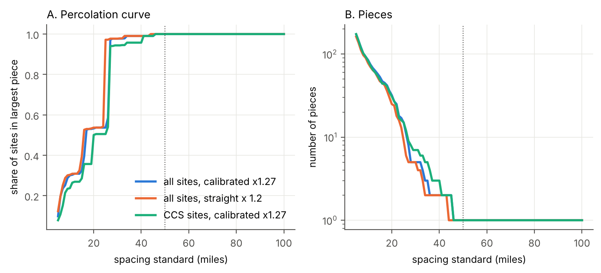
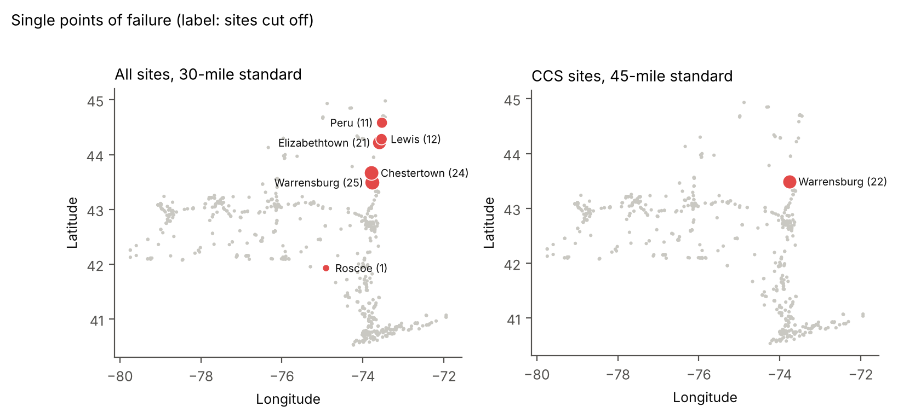
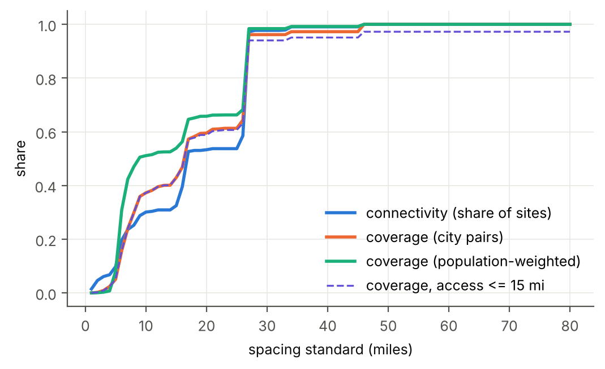
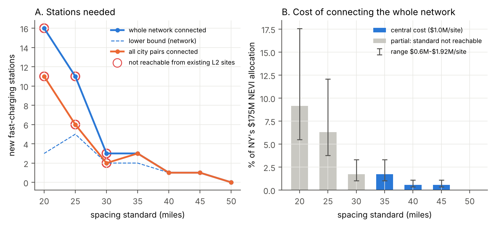
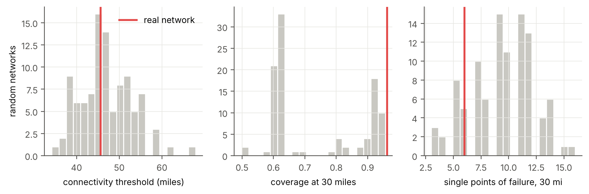

# Coverage Is Not Connectivity: Connectivity Thresholds, Critical Stations, and the Cost of Robustness in New York State's EV Fast-Charging Network

Nov 19, 2026

Joubin Zahiri Khameneh · Shamim Sharbaf · Zeinab Davoodmanesh

SSIE 641 Advanced Topics in Network Science · Final project report · Code: [github.com/sharbafshamim/ssie641-ev-network](https://github.com/sharbafshamim/ssie641-ev-network)

## Abstract

New York's public DC fast-charging network becomes one connected network once a driver can cover about 44 to 46 miles between chargers. Below that, it breaks apart at a handful of small rural sites in the Adirondacks and the North Country. We model the 754 fast-charging sites in the Department of Energy's station list (September 23, 2026) as an epsilon-neighbourhood network and treat the spacing standard as the variable, not a fixed assumption. That matters because federal guidance dropped the 50-mile spacing rule in August 2025 and left the number to the states.

Three results follow. First, the whole network is connected from 43.5 miles on road distances (45.6 miles on calibrated straight-line distances). The weakest link is Saranac Lake to Malone, and the network first splits into its two large regions below about 27 miles. Second, the sites that hold the network together are isolated, not small: at a 30-mile standard six sites are single points of failure, with a median of 7.5 neighbours against 47 for all sites, yet a median of 5 ports against 4. Removing the 18 highest-betweenness sites (2.4% of the network) cuts the largest connected piece below 90% at 50 miles, while removing the 18 busiest sites by degree does almost nothing. Third, a 50-mile standard needs no new stations. Standards of 35 to 45 miles need one to three, all in the North Country, at well under 4% of New York's $175 million NEVI allocation. Standards below 30 miles cannot be met by upgrading existing public charging locations at all. A random-siting control shows the real network is better placed than 100% of random alternatives at 30 miles, but no better than chance on the overall threshold: the remaining gap is a matter of geography.

## 1. Introduction

Charging policy is usually measured by coverage: the share of drivers who live near a charger. Coverage and travel are different questions. A region can have many chargers and still be impossible to cross if one gap in the middle is longer than a car can drive. Coverage is a local property; being able to finish a trip is a property of the whole network.

The question matters now. The federal NEVI program's earlier guidance asked states to build fast chargers no more than 50 miles apart along designated Alternative Fuel Corridors. The program's codified standards (23 C.F.R. pt. 680) set equipment minimums but never a spacing rule. On August 11, 2025, the U.S. Department of Transportation issued interim final guidance that replaced all earlier guidance and dropped the 50-mile spacing requirement, leaving states to set their own distances ([Electrification Coalition, 2025](https://electrificationcoalition.org/resource/national-electric-vehicle-infrastructure-nevi-program-updated-guidance/); [Atlas Public Policy, 2025](https://www.atlasevhub.com/weekly-digest/nevi-guidance-whats-changed-and-whats-next/)). New York therefore has to choose a number, and we know of no analysis that says what the number should be or what the alternatives would cost.

New York is a good test case. Its 754 fast-charging sites are spread unevenly between the dense downstate region and a sparse, mountainous north. Its winters cut usable range: in AAA's 2019 tests, five electric vehicles at 20°F with the heater on lost 41% of their range on average ([AAA, 2019](https://newsroom.aaa.com/wp-content/uploads/2019/06/AAA-Electric-Vehicle-Range-Testing-Report.pdf)). And the main routes to Canada, I-87 toward Montreal and I-81 toward Ontario, run through the emptiest parts of the state.

We ask three questions:

1. **Q1.** How close is New York's charging network to breaking apart, and where is it closest?
2. **Q2.** Which stations hold the network together, and are they the big stations or the small ones?
3. **Q3.** For each standard the state might set, how many new stations would it need, and can it afford them?

We answer Q3 across a range of standards rather than at one number. The result is a cost curve on which the state can place its own budget and its own choice of standard.

## 2. Related work

Three recent studies come closest to this project; all three fix the spacing threshold in advance.

[Hanig et al. (2025)](https://doi.org/10.1038/s41467-024-55696-8) define a consecutive-coverage metric: the traffic-weighted share of roads within 500 miles of a county that can be driven without a charging gap of 50 miles or more. In 2023, 10% of U.S. counties had at least 75% minimum viable coverage; if every designated corridor received fast chargers, 94% would, and the counties left behind are rural. The 50-mile gap length is an assumption of the method.

[Hamim, Chen and Ukkusuri (2025)](https://ideas.repec.org/a/eee/jotrge/v128y2025ics0966692325002406.html) build charging-station networks for twelve U.S. states and measure the loss of global efficiency under random and targeted station removal. They find more resilience to random than to targeted removal, and that the most critical stations do not always sit where EV charging demand is highest. Efficiency can fall without the network actually splitting, so this ranks stations by importance rather than identifying the ones whose loss would leave a region unreachable.

[Zhang, Chen, Tu and Yin (2022)](https://doi.org/10.3390/wevj13070127) build station-proximity networks for Wuhan and Hangzhou and test how they break under attack, again at one fixed threshold.

The facility-location literature does cost such decisions, most directly through the flow-refueling location model of [Kuby and Lim (2005)](https://doi.org/10.1016/j.seps.2004.03.001), but one vehicle range at a time.

Three gaps follow, and this project addresses each one:

- No study treats the spacing threshold as the quantity to be determined, which is exactly the question the 2025 guidance now gives states.
- Existing work ranks stations by importance but does not identify the individual stations whose loss cuts a region off.
- No study traces how the number of stations needed changes across the range of standards a state might choose.

## 3. Data

All inputs are public and are included in the code repository.

| Dataset | Source | What we use |
| --- | --- | --- |
| Fast-charging stations, NY, Sep 23, 2026 | [DOE Alternative Fuels Data Center](https://afdc.energy.gov/stations) | 755 open, public stations with DC fast ports; 3,408 fast ports |
| All public charging, NY, Oct 13, 2026 | DOE Alternative Fuels Data Center | 4,756 Level 1/Level 2 locations as candidate sites; 793 fast-charging sites for the robustness check |
| Census 2020 place centroids | [Census Gazetteer files](https://www.census.gov/geographies/reference-files/time-series/geo/gazetteer-files.html) | internal point of 1,293 New York places |
| Census 2020 place population | [Census P.L. 94-171, table P1](https://data.census.gov/) | total population per place |
| Road distances | [OSRM](https://project-osrm.org/) on OpenStreetMap | 754 × 754 driving distances (notebook v3) |

**Stations and sites.** We keep only DC fast charging. A Level 2 charge takes hours, so it does not support travel between cities, and including it would let dense city charging hide the rural pattern. Stations at identical coordinates are merged into one site, which joins only the two New Baltimore Thruway travel plazas: 754 sites. Of these, 661 offer a CCS plug, which most non-Tesla cars use; 87 stations are Tesla-only. ChargePoint (188 stations), Tesla (125) and Electrify America (86) operate the most stations.

**Cities.** We join the Gazetteer to the census counts on place code and keep the 362 places with at least 5,000 people. They hold 15.3 million people: 76% of New York's 20.2 million residents. The rest live in towns outside any village or census-designated place. New York City is a single place of 8.8 million people, so pairs that include it carry 73% of all population-weighted city pairs. We therefore report weighted coverage both with and without New York City.

**Candidate sites.** New fast chargers are placed only at locations that already host public Level 1 or Level 2 charging: open, public, with no DC fast ports. They already have a grid connection and a host business. Merging identical coordinates gives 4,756 candidate locations.

**Distances.** For the 754 sites, notebook v3 queried driving distances from the public OSRM server. The median ratio of road to straight-line distance, over all pairs more than 5 miles apart, was 1.27, with 90% of pairs between 1.10 and 1.48. This is above the 1.2 factor of [Ballou, Rahardja and Sakai (2002)](<https://doi.org/10.1016/S0965-8564(01)00044-1>) that the proposal assumed. The final pipeline uses straight-line distance × 1.27 for every link, calibrated on those road distances, because the stored road matrix was not available for the final run and the OSRM server was not reachable from our environment. In v3 the road and straight-line versions gave the same weakest links and thresholds within 1 mile (43.5 vs 43.1 miles); we quote the road values where v3 measured them. The pipeline uses the road matrix automatically when the file is present.

**Limits.** The data shows what is installed, not what is working on a given day, so results describe the network as built. Coordinates are reported by operators and are not audited.

## 4. Methods

Every measure below is computed for each spacing standard ε, from a strict standard to a loose one. Code is in `src/evnet/`; `scripts/run_all.py` reproduces every table and figure in about three minutes.

**Network.** Each site is a node. Two sites are linked when the distance between them is at most ε miles: an epsilon-neighbourhood (random geometric) graph. ε is the spacing standard, the distance a driver must be able to cover between chargers. We build two versions: all 754 sites, and the 661 CCS sites, which is the network a non-Tesla car can use.

**Q1: where the network splits.** For ε from 5 to 100 miles we record the number of connected pieces and the share of sites in the largest piece (a percolation curve). The smallest ε at which the network is one piece equals the longest link of its minimum spanning tree (MST), so we compute it exactly. The MST's longest links, in order, are the weakest links in the state. We map the pieces just below the main jump.

**Q2: which stations hold it together.** An articulation point (cut vertex) is a site whose removal alone splits its piece of the network: a single point of failure. For each one we count the sites cut off from the rest. To answer "big or small", we compare critical and non-critical sites on degree (number of neighbours within ε) and on ports (station size). We then test robustness three ways, following the course's Module 3 material:

- *Random failure:* each site fails independently with probability p from 0 to 0.6, 100 trials per p. We report the largest piece as a share of all sites (upper bound 1 − p) and as a share of surviving sites (upper bound 1).
- *Targeted attack:* the adaptive version, which removes the top site, recomputes scores and repeats. Scores are degree and betweenness centrality.
- *Robustness index R:* the mean of the largest-piece curve over the removal fractions.

**Coverage.** Connectivity counts sites, so the dense New York City and Long Island area, about a third of all sites, dominates it. Coverage instead counts pairs of cities. A city is attached to every site within ε of its centre, i.e. a driver leaving home with a full battery of usable range ε. Two cities are connected if a site attached to one and a site attached to the other are in the same piece. With A(c) the set of pieces city c touches and P the population:

```latex
\text{coverage}(\varepsilon) = \frac{1}{n(n-1)} \sum_{a \neq b} \mathbf{1}\left[A(a) \cap A(b) \neq \emptyset\right], \qquad \text{weighted: } \frac{\sum_{a \neq b} P_a P_b \, \mathbf{1}[\cdot]}{\sum_{a \neq b} P_a P_b}
```

As a sensitivity check we cap the access distance at 15 miles, so a city far from any charger cannot count as served through a long first leg.

**Q3: how many new stations.** For each ε we ask how few candidate locations must be upgraded to fast charging so that (a) every existing site is in one network, the proposal's definition, or (b) every pair of cities is connected. This is a node-weighted Steiner tree problem: the pieces (or cities) are terminals, each candidate costs one station, and nodes within ε are linked. Cities are leaves: a city can attach to the network, but a driver cannot recharge there, so a city never joins two pieces. The problem is NP-hard. We use the shortest-path heuristic of [Takahashi and Matsuyama (1980)](https://cir.nii.ac.jp/crid/1570009750462176256): start from the largest piece, repeatedly join the terminal reachable through the fewest new stations, then drop any station that turns out to be redundant. This gives an upper bound. For objective (a) we also report a lower bound: every plan must connect the largest piece to the farthest piece, so the fewest stations on that one path is a floor. If some piece cannot be reached even with every candidate upgraded, the standard is infeasible with existing locations. Links to new stations use the same 1.27 detour factor; we repeat Q3 at 1.2 as a sensitivity check. This replaces the greedy search of notebook v3, which had no bound and could stop early.

**Budget.** New York's five-year NEVI formula apportionment is $175 million through September 2026 ([NYSDOT, 2025](https://ebtc.info/wp-content/uploads/2025/05/NEVI-Powerpoint-EBTC-NYSDOT-2025-1-1.pdf)). Per-site cost varies with grid conditions, so we use three levels for a NEVI-style site of four 150 kW ports: $0.6 million (low end of construction estimates), $1.0 million (average total cost of NEVI projects, $0.92–$1.05 million, [Paren via Denver Gazette, 2024](https://www.denvergazette.com/2024/12/31/colorado-granted-another-17-3-million-by-the-federal-government-to-add-more-ev-fast-chargers-c1197d88-c70c-11ef-bf3d-07ca681e048a/)), and $1.92 million (NYSERDA's maximum award of $1.536 million at its 80% cost share, [Barclay Damon, 2024](https://www.barclaydamon.com/alerts/175-million-of-federal-funds-available-for-electric-vehicle-chargers-in-new-york-state)). Results are stated in stations first and dollars second.

**Winter.** We rerun the analysis with effective range 0.59 × ε, the 41% loss AAA measured at 20°F with cabin heat.

**Control.** Some fragility comes from the shape of New York itself. To separate geography from siting decisions, we draw 754 locations at random, without replacement, from the pool of all 5,510 public charging locations (fast plus Level 1/2), 100 times, and compute the same measures. The question is: given the sites actually available, was the fast-charging network sited well?

**Robustness.** We repeat Q1, Q2 and Q3 on the October 13, 2026 station list, which has 39 more fast-charging sites.

## 5. Q1: When does the network split?

**Answer: New York's fast-charging network is one connected network from 43.5 road miles (45.6 calibrated), and it is closest to breaking in the North Country, between Saranac Lake and Malone.** The 50-mile benchmark of the former federal guidance is already met with 4 to 6 miles to spare.

The percolation curve has one sharp jump (Figure 1). Below 26 miles the largest piece holds only 54–59% of sites: the state is split into a downstate-plus-Capital-Region piece (405 sites at 24 miles) and a western-and-central piece (280 sites), plus 15 small pieces in the Southern Tier, the Adirondacks and the North Country (Figure 2). At 27 miles the two large pieces join along the Thruway corridor and the largest piece jumps to 97% of sites. From there, the remaining small pieces join one at a time: five pieces at 28–32 miles, two from 36 to 45 miles, and one from 46 miles.

The network's weakest links are the longest links of its minimum spanning tree. All five are rural, and four are in the Adirondacks or the North Country:

| Rank | Link | Calibrated miles | Straight × 1.2 miles |
| --- | --- | --- | --- |
| 1 | Saranac Lake – Malone | 45.6 | 43.1 |
| 2 | Malone – Massena | 35.8 | 33.9 |
| 3 | Pulaski – Watertown | 34.0 | 32.1 |
| 4 | Chestertown – Indian Lake | 32.1 | 30.3 |
| 5 | Monticello – Roscoe | 27.9 | 26.3 |

The road-distance run in notebook v3 gave the same top link at 43.5 miles. On that top link the proposal's 1.2 factor is 0.4 miles short of the road distance and the median 1.27 factor is 2.1 miles long: mountain roads in the North Country run straighter than the state average. All three distance versions agree on which links are weakest.

For a non-Tesla driver the picture is similar at the top but more fragile in the middle. The CCS-only network also becomes one piece at 46 miles. But at 30 miles it is in 7 pieces rather than 5, because some links, such as Warrensburg to North Hudson (40.5 miles), are bridged only by Tesla-only sites.



*Figure 1. Share of sites in the largest piece (A) and number of pieces (B) by spacing standard. The dotted line marks the former 50-mile benchmark.*


*Figure 2. The pieces of the network at 24 miles, just below the main jump. The eight largest are coloured.*

## 6. Q2: Which stations hold the network together?

**Answer: a handful of isolated rural sites, half of them Tesla Superchargers and half car dealers or public chargers, not the big downstate hubs.** They are "small" only by degree, the number of neighbours: by ports they are typical or larger.

### 6.1 Single points of failure

At a 30-mile standard six sites are cut vertices (Figure 3). Each one alone cuts a region off from the rest of the state:

| Site | Operator | Neighbours | Ports | Sites cut off |
| --- | --- | --- | --- | --- |
| Warren Ford, Warrensburg | Ford dealer | 16 | 2 | 25 |
| Tesla Supercharger, Chestertown | Tesla | 3 | 6 | 24 |
| Egglefield Bros, Elizabethtown | Ford dealer | 8 | 2 | 21 |
| EVolve NY, Lewis | Electrify America | 7 | 4 | 12 |
| Tesla Supercharger, Peru | Tesla | 11 | 8 | 11 |
| Tesla Supercharger, Roscoe | Tesla | 4 | 8 | 1 |

Five of the six lie on the I-87 Northway corridor between Lake George and Plattsburgh. Their median degree is 7.5 against 47 for all sites, so all six sit in the bottom 19% by degree. Their median port count is 5 against 4 for all sites, and the two Peru and Roscoe Superchargers are in the top quarter by ports. The pattern holds across standards: at 25 to 40 miles the critical sites' median degree is 6 to 13 against 41 to 63 for all sites, while their median ports stay at 4 to 7. Degree is a measure of where a site is, not of how big it is, and here it is a poor guide to importance.

The number of cut vertices falls from 9 to 18 at 20–23 miles to two or fewer from 38 miles, and to none from 49 miles. For CCS drivers one site matters most: at 45 miles, Warren Ford in Warrensburg, a two-port dealer charger, is the only link between the Capital Region and 22 Adirondack and North Country sites.



*Figure 3. Single points of failure: all sites at 30 miles (left) and CCS sites at 45 miles (right). Labels give the number of sites each one cuts off.*

### 6.2 Random failure and targeted attack

The network tolerates random failure well and targeted attack on its bridges badly (Figure 4).

| Standard | Random failure R | Attack by degree R | Attack by betweenness R | Betweenness removals until largest piece < 90% |
| --- | --- | --- | --- | --- |
| 50 miles | 0.696 | 0.677 | 0.231 | 18 |
| 30 miles | 0.635 | 0.618 | 0.157 | 7 |

R is the mean largest-piece share over 0 to 60% of sites removed; its upper bound is 0.70. Under random failure at 50 miles the network stays close to that bound: even when 60% of sites fail, 97% of the survivors are still in one piece (64% at 30 miles). An attack by degree removes busy Westchester and Long Island sites first (Thornwood, Hartsdale, White Plains) and does no more damage than random failure: after 18 removals the largest piece still holds 97.6% of sites. An attack by betweenness removes the rural corridor sites first: Monticello, Arkville, Roscoe, Tannersville, Richmondville, then Frankfort, Herkimer and Little Falls on the Mohawk Valley. Eighteen such removals, 2.4% of the network, cut the largest piece below 90% at 50 miles; at 30 miles seven are enough. This matches Hamim et al.'s finding that targeted removal is far more damaging than random removal, but here the damage is concentrated in identifiable rural sites.


*Figure 4. Largest piece as a share of all sites under random failure (100 trials per p), attack by degree, and attack by betweenness, at 50 and 30 miles.*

### 6.3 Coverage is not connectivity

Measured by people and cities instead of sites, the network looks better at loose standards and worse at strict ones (Figure 5). Half of the 362 cities have a fast charger within 2.0 miles of their centre; the farthest are Ogdensburg (29.7 miles), Norwich (21.1), Albion (19.1), Medina (18.6) and Port Jervis (17.5).

| Standard | Connectivity (sites) | Coverage (city pairs) | Coverage, population-weighted | Weighted, without NYC | Coverage, access ≤ 15 mi |
| --- | --- | --- | --- | --- | --- |
| 20 miles | 0.533 | 0.595 | 0.658 | 0.543 | 0.588 |
| 30 miles | 0.978 | 0.962 | 0.984 | 0.975 | 0.940 |
| 40 miles | 0.991 | 0.973 | 0.992 | 0.987 | 0.951 |
| 50 miles | 1.000 | 1.000 | 1.000 | 1.000 | 0.973 |

At 30 to 45 miles almost every site is connected (98–99%), yet about 3% of city pairs are not: the cut-off North Country pieces contain few sites but several cities (Malone, Massena, Potsdam, Canton, Ogdensburg). Every pair of cities is connected from 46 miles. With access capped at 15 miles, coverage never reaches 1, because Ogdensburg, Norwich, Albion, Medina and Port Jervis have no charger within 15 miles: for those cities the problem is access, not spacing.

Under failure, coverage separates the two attacks even more clearly. At 50 miles, random failure and degree attack leave coverage at R = 0.99 and 0.98, but betweenness attack cuts it to 0.43 (0.50 population-weighted). What breaks is the link between regions, not service within a region.



*Figure 5. Connectivity (share of sites) versus city-pair coverage, plain, population-weighted, and with city access capped at 15 miles.*

## 7. Q3: How many new stations does each standard need, and can New York afford them?

**Answer: none at 50 miles, one to three between 35 and 45 miles, all in the North Country, and the cost is a small fraction of the federal budget. Below 30 miles, money is not the constraint: no existing public charging location lies along the North Country gaps.**

### 7.1 The cost curve

The table gives the stations needed to put every existing site into one network (objective a), with the heuristic's lower and upper bounds, and the cost at the central $1.0 million per site (Figure 6).

| Standard | Pieces now | Lower bound | New stations | Where (upgraded Level 2 locations) | Central cost | Share of $175M |
| --- | --- | --- | --- | --- | --- | --- |
| 50 miles | 1 | 0 | 0 | none needed | $0 | 0% |
| 45 miles | 2 | 1 | 1 | Malone | $1.0M | 0.6% |
| 40 miles | 2 | 1 | 1 | Paul Smiths | $1.0M | 0.6% |
| 35 miles | 3 | 2 | 3 | Ogdensburg, Gouverneur, Massena | $3.0M | 1.7% |
| 30 miles | 5 | 2 | 3+, infeasible | Newcomb, Lowville, Camden; Malone–Massena–Potsdam unreachable | — | — |
| 25 miles | 15 | 5 | 11+, infeasible | 11 sites, Catskills to Thousand Islands; Malone–Massena–Potsdam unreachable | — | — |
| 20 miles | 32 | 3 | 16+, infeasible | 16 sites; 18 northern towns unreachable | — | — |

Where the upper bound equals the lower bound (50, 45 and 40 miles), the count is optimal. At 45 miles the one station is an artifact of the 1.27 factor: on road distances the network is already connected at 43.5 miles, so 45 miles needs none. Across the cost range of $0.6–$1.92 million per site, the feasible standards cost between $0 and $5.8 million, at most 3.3% of New York's NEVI allocation, which could fund 91 to 291 such sites.

The stricter standards fail for a physical reason. At 30 miles and below, the piece around Malone, Massena and Potsdam cannot be reached even if every one of the 4,756 public Level 1/Level 2 locations were upgraded: no chain of existing locations crosses the gap within the standard. Meeting those standards needs new host sites, which is a siting and grid-connection problem rather than a budget problem.

Two checks change the details but not this conclusion:

- *Detour factor.* With the proposal's 1.2 factor for new links, 30 miles becomes feasible with six stations (Newcomb, Lowville, Camden, Canton, Gouverneur, Hogansburg) and 35 miles needs two (Paul Smiths, Massena). 25 and 20 miles stay infeasible. Whether 30 miles is reachable at all depends on a few road miles in the St. Lawrence Valley, which is where true road distances matter most.
- *Coverage objective.* Connecting every pair of cities, rather than every site, needs the same number of stations: 0 at 50 miles, 1 at 40–45 miles, 3 at 35 miles (Gouverneur, Canton, Massena), and it is infeasible below 35 miles at the 1.27 factor. Notebook v3's greedy search reported 3 stations at 30 miles using the 1.2 factor; at that factor our method also connects every city pair at 30 miles, with 6 stations.



*Figure 6. (A) New stations needed for each standard, for the whole network and for all city pairs; red circles mark standards that cannot be met from existing locations. (B) Cost of connecting the whole network as a share of New York's $175M NEVI allocation; grey bars are partial counts for infeasible standards.*

### 7.2 Winter

Winter makes the network need a much longer nominal range (Figure 7). With 41% less range, a driver needs a nominal 74 road miles (77 calibrated) between chargers for the whole network to be connected. At the old 50-mile benchmark, the winter-effective range of 29.5 miles leaves the network in five pieces and 4% of city pairs disconnected, and the North Country gap cannot be closed from existing locations. A nominal 60-mile standard (35.4 effective) needs two winter stations, at Paul Smiths and Massena; a 70-mile standard needs one, at Paul Smiths. A North Country station at Paul Smiths or Massena does double duty: it tightens the summer standard and keeps the region connected in winter.


*Figure 7. City-pair coverage by nominal spacing standard, in mild weather and with a 41% winter range loss.*

## 8. Control and robustness checks

### 8.1 Is the network well sited?

**Answer: yes along the corridors, no better than chance at the edges.** We compare the real network with 100 random networks of 754 locations drawn from all 5,510 public charging locations in New York (Figure 8).

| Measure | Real network | Random mean | Random 5th–95th percentile | Random draws that do better |
| --- | --- | --- | --- | --- |
| Connectivity threshold (miles) | 45.6 | 46.9 | 38.1–56.1 | 43% |
| Coverage at 30 miles | 0.962 | 0.733 | 0.596–0.946 | 0% |
| Weighted coverage at 30 miles | 0.984 | 0.775 | 0.653–0.975 | 0% |
| Pieces at 30 miles | 5 | 9.7 | 7–14 | 0% |
| Single points of failure at 30 miles | 6 | 9.4 | 5–14 | 13% |
| Coverage at 40 miles | 0.973 | 0.947 | 0.654–1.000 | 29% |

At 30 miles the real network beats every random draw on coverage and on the number of pieces. Random draws often split the state into two large halves; the real network avoids that because fast chargers were placed along the Thruway and the other main corridors. The overall threshold, by contrast, is ordinary: 43% of random networks connect the whole state at a shorter distance. Random networks do not close the North Country gap either, because the available locations are where people and businesses are. The remaining weak point is therefore geographic, which agrees with Q3: closing it needs new host sites, not better choices among existing ones.



*Figure 8. The real network (red line) against 100 random networks drawn from all 5,510 public charging locations.*

### 8.2 Newer station data

The October 13, 2026 station list has 793 fast-charging sites, 39 more than September. Of the 48 stations added, 18 are EVolve NY stations opened in 2020–2022 that were missing from the September extract, including Keene, Schroon Lake, Westport and Liberty in the Adirondacks and Catskills. The headline results do not change: the threshold stays at 45.6 calibrated miles, the weakest link is still Saranac Lake – Malone, and Q3 still needs 3, 3 and 1 stations at 30, 35 and 40 miles. The critical sites change at the edges: at 30 miles Elizabethtown is no longer a cut vertex, and at 35 miles only Peru remains, most likely because the new Schroon Lake site gives the Northway corridor a second route past Chestertown.

### 8.3 Other checks

- *Population weighting.* Removing New York City's weight lowers weighted coverage at 20 miles from 0.66 to 0.54 but changes it by less than 0.01 from 30 miles up. The conclusions do not depend on New York City's size.
- *Plug type.* The CCS-only network has the same threshold and the same weakest link but more pieces at strict standards, and its single most critical site is a two-port dealer charger (Warrensburg).

## 9. Discussion

**What a state should take from this.** The choice of standard is a choice about one region. Everywhere south of the Adirondacks, New York's network is connected by 28 miles; every decision between 30 and 50 miles is about the North Country. At 50 miles the state has nothing to build. At 35 to 45 miles it needs one to three stations around Malone, Paul Smiths, Massena, Gouverneur and Ogdensburg, at 1–3% of its NEVI allocation. Below 30 miles it needs new host sites where none exist today. A state that sets a standard on coverage figures alone would miss this, because the cut-off region holds only 1–2% of sites and 3–4% of city pairs.

**Protecting what exists.** The sites that matter most are not the ones a capacity-based or demand-based plan would protect. Two-port dealer chargers in Warrensburg and Elizabethtown and three rural Superchargers carry the connection between regions. Reliability requirements, maintenance priority and backup power for these few sites would protect statewide travel more than adding ports where chargers are already dense. Betweenness, not degree, is the measure that finds them.

**Coverage is not connectivity.** The two measures disagree in both directions. At 30–45 miles almost every site is connected while 3% of city pairs are not; with a 15-mile access cap, five cities stay unserved at any spacing. A spacing standard cannot fix an access gap, and a coverage target cannot fix a spacing gap.

### Limitations

- *Distances.* The final run uses straight-line distance × 1.27, calibrated on OSRM road distances, rather than the road matrix itself. The two agree on the weakest links and on thresholds within 2 miles, but whether 30 miles is feasible depends on a few miles in the St. Lawrence Valley.
- *Installed, not working.* The station list records installed equipment. Real availability is lower, which makes the single points of failure matter more than this analysis shows.
- *Plug access.* We treat Tesla-only sites as unusable for other cars. Some are being opened to other brands, which the data does not record.
- *Heuristic.* Q3 counts are upper bounds; they equal the lower bound only at 40–50 miles.
- *Cost.* Per-site costs are national NEVI averages and a NYSERDA award cap, not New York site estimates; grid upgrades in remote areas may cost more.
- *Network model.* A link means two sites are within range, not that a driver would route that way, and traffic is not modelled.

### Conclusion

New York's fast-charging network already meets the former 50-mile federal benchmark, and is better sited along its main corridors than random placement from the same locations would be. Its weak points are a few isolated rural chargers that link the regions, and one geographic gap in the North Country that no existing public charging location can bridge at strict standards. Protecting the corridor chargers and adding one to three North Country stations would do more for statewide travel than any number of chargers where chargers are already dense.

**Future work.** Rerun every link on true road distances; repeat the analysis for a second, lower-density state; and add station reliability data so that "installed" can be replaced by "working".

## Code and data availability

All code, input data, result tables and figures are at [github.com/sharbafshamim/ssie641-ev-network](https://github.com/sharbafshamim/ssie641-ev-network). `python scripts/run_all.py` rebuilds every table and figure; `notebooks/ev_network_final.ipynb` walks through the results question by question.

## Acknowledgements

Station data is provided by the U.S. Department of Energy's Alternative Fuels Data Center; population data by the U.S. Census Bureau; road distances by the OSRM project on OpenStreetMap data. An AI assistant (Claude, Anthropic) was used to review the literature, check the regulatory and cost sources, refactor and extend the analysis code, and draft this report. The authors are responsible for the research questions, the framing, and the final interpretations.

## References

- American Automobile Association. (2019). *AAA electric vehicle range testing.* <https://newsroom.aaa.com/wp-content/uploads/2019/06/AAA-Electric-Vehicle-Range-Testing-Report.pdf>
- Atlas Public Policy. (2025). NEVI guidance: What's changed and what's next. *EV Hub Weekly Digest.* <https://www.atlasevhub.com/weekly-digest/nevi-guidance-whats-changed-and-whats-next/>
- Ballou, R. H., Rahardja, H., & Sakai, N. (2002). Selected country circuity factors for road travel distance estimation. *Transportation Research Part A, 36*(9), 843–848. <https://doi.org/10.1016/S0965-8564(01)00044-1>
- Barclay Damon LLP. (2024). $175 million of federal funds available for electric vehicle chargers in New York State. <https://www.barclaydamon.com/alerts/175-million-of-federal-funds-available-for-electric-vehicle-chargers-in-new-york-state>
- Csardi, G., & Nepusz, T. (2006). The igraph software package for complex network research. *InterJournal, Complex Systems,* 1695. <https://igraph.org>
- Electrification Coalition. (2025). National Electric Vehicle Infrastructure (NEVI) program updated guidance. <https://electrificationcoalition.org/resource/national-electric-vehicle-infrastructure-nevi-program-updated-guidance/>
- Federal Highway Administration. (2025). National Electric Vehicle Infrastructure Formula Program guidance (interim final). 90 Fed. Reg. 39025 (Aug. 13, 2025). Docket No. FHWA-2025-0010.
- Hamim, O. F., Chen, X., & Ukkusuri, S. V. (2025). Developing a framework for resilience assessment of electric vehicle charging station networks. *Journal of Transport Geography, 128,* 104349. <https://doi.org/10.1016/j.jtrangeo.2025.104349>
- Hanig, L., Ledna, C., Nock, D., Harper, C. D., Yip, A., Wood, E., & Spurlock, C. A. (2025). Finding gaps in the national electric vehicle charging station coverage of the United States. *Nature Communications, 16,* 561. <https://doi.org/10.1038/s41467-024-55696-8>
- Kuby, M., & Lim, S. (2005). The flow-refueling location problem for alternative-fuel vehicles. *Socio-Economic Planning Sciences, 39*(2), 125–145. <https://doi.org/10.1016/j.seps.2004.03.001>
- Luxen, D., & Vetter, C. (2011). Real-time routing with OpenStreetMap data. *Proceedings of the 19th ACM SIGSPATIAL GIS,* 513–516. <https://project-osrm.org>
- National Electric Vehicle Infrastructure Standards and Requirements, 23 C.F.R. pt. 680 (2023). 88 Fed. Reg. 12752. <https://www.govinfo.gov/content/pkg/FR-2023-02-28/html/2023-03500.htm>
- New York State Department of Transportation. (2025). *NEVI formula program update* (Eastern Border Transportation Coalition, May 2025). <https://ebtc.info/wp-content/uploads/2025/05/NEVI-Powerpoint-EBTC-NYSDOT-2025-1-1.pdf>
- New York State Energy Research and Development Authority. (n.d.). National Electric Vehicle Infrastructure (NEVI) Program. <https://www.nyserda.ny.gov/All-Programs/Charging-Station-Programs/National-Electric-Vehicle-Infrastructure-Program>
- Paren, as reported by Denver Gazette. (2024, Dec. 31). Colorado granted another $17.3 million by the federal government to add more EV fast-chargers. <https://www.denvergazette.com/2024/12/31/colorado-granted-another-17-3-million-by-the-federal-government-to-add-more-ev-fast-chargers-c1197d88-c70c-11ef-bf3d-07ca681e048a/>
- Takahashi, H., & Matsuyama, A. (1980). An approximate solution for the Steiner problem in graphs. *Mathematica Japonica, 24*(6), 573–577.
- U.S. Census Bureau. (2021). *2020 Census Redistricting Data (P.L. 94-171), table P1;* *2020 Gazetteer files, places.* <https://www.census.gov/geographies/reference-files/time-series/geo/gazetteer-files.html>
- U.S. Department of Energy, Alternative Fuels Data Center. (2026). Alternative fueling station locator. Retrieved September 23 and October 13, 2026. <https://afdc.energy.gov/stations>
- Zhang, P., Chen, J., Tu, L., & Yin, L. (2022). Layout evaluation of new energy vehicle charging stations: A perspective using the complex network robustness theory. *World Electric Vehicle Journal, 13*(7), 127. <https://doi.org/10.3390/wevj13070127>
